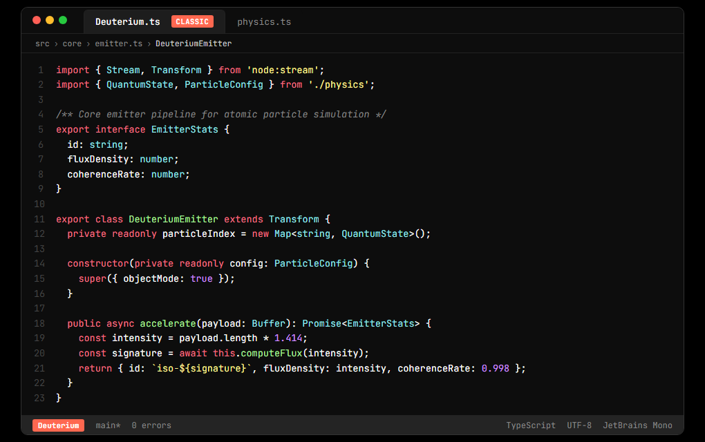
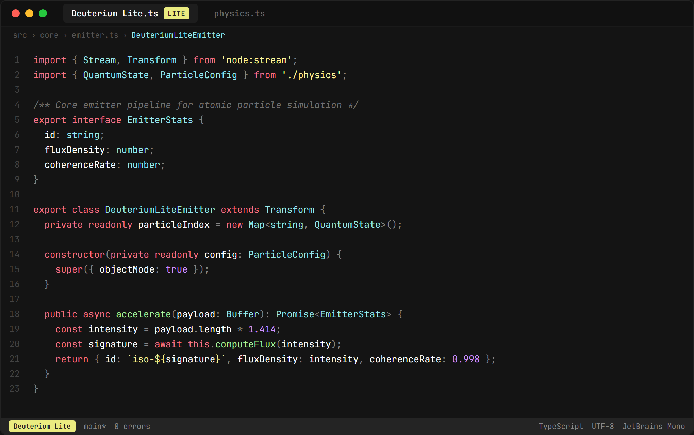

# Deuterium Color Themes

[](https://open-vsx.org/extension/andreidurlea/deutherium)

Dark color themes for Visual Studio Code in two variants, **Deuterium** (`#0d0d0d` editor background) and **Deuterium Lite** (`#141414`), with a selectable UI accent color. Syntax colors follow Lotus Dark (Classic) for JetBrains IDEs, the same colors as the [Deuterium JetBrains plugin](https://plugins.jetbrains.com/plugin/36393-deuterium).

---

## Download & Install

Install directly through your preferred extension marketplace:

- [VS Code Marketplace](https://marketplace.visualstudio.com/items?itemName=andreidurlea.deutherium)
- [Open VSX Registry](https://open-vsx.org/extension/andreidurlea/deutherium)

Alternatively, search for `Deuterium` in the Extensions view (`Ctrl+Shift+X` / `Cmd+Shift+X`) in Visual Studio Code and select **Install**.

The extension runs on the local machine, so the themes also apply in remote windows (SSH, WSL, Dev Containers) without installing it on the remote host.

---

## Theme Previews

### Deuterium (Classic)



---

### Deuterium Lite



---

## Activation

1. Open the Color Theme picker using `Ctrl+K Ctrl+T` (or `Cmd+K Cmd+T` on macOS).
2. Select **Deuterium** or **Deuterium Lite**.

> [!TIP]
> For the intended typography and rendering, the [JetBrains Mono](https://fonts.google.com/download?family=JetBrains%20Mono) font is recommended.

---

## Syntax Colors

Token colors come from Lotus Dark (Classic) by Brian Lai, used under the MIT License (`LICENSE-lotus-theme-jetbrains`), except keywords, which use the upright Deuterium red `#f57385` instead of the italic Lotus `#ff6188`. TextMate scopes set the base colors, and semantic tokens separate declarations from calls, parameters from variables, and interfaces from classes.

| Role | Color | TextMate scope or semantic token |
| :- | :- | :- |
| Keyword, modifier, `this`, `true` | `#f57385` | `keyword`, `storage`, `constant.language`, `variable.language` |
| String | `#fff48a` | `string` |
| Number | `#c994ff` | `constant.numeric` |
| Escape, template expression | `#78dce8` | `constant.character.escape`, `punctuation.definition.template-expression` |
| Class, object, enum, type | `#33f3ff` | `entity.name.type`, `support.class`, semantic `class`, `type` |
| Interface, type parameter, decorator | `#78dce8` italic | semantic `interface`, `typeParameter`, `decorator` |
| Function declaration | `#a9dc76` | `entity.name.function.declaration`, semantic `function.declaration`, `method.declaration` |
| Function call | `#99ffae` | `entity.name.function.call`, `support.function`, semantic `function`, `method` |
| Parameter | `#ffcfa8` italic | `variable.parameter`, semantic `parameter` |
| Variable, property | `#fcfcfa` | `variable`, semantic `variable`, `property` |
| Operator | `#c0aaff` | `keyword.operator` |
| Punctuation | `#939293` | `punctuation`, `meta.brace` |
| Comment | `#727072` italic | `comment` |

Tokens without a scope use `editor.foreground`, set to the punctuation color `#939293`. In Kotlin this covers `:`, `.` and brackets, which the Kotlin grammar leaves unscoped.

---

## Accent Color Customization

The accent color applies to the status bar, buttons and progress bar. Syntax colors do not change with it. Button text is black or white, whichever has the higher contrast with the accent. Status bar text follows `deuterium.statusBarColor` unless `deuterium.statusBarTextColor` sets it.

1. Open the Command Palette (`Ctrl+Shift+P` / `Cmd+Shift+P`).
2. Type `Deuterium: Select Accent Color`.
3. Choose a preset or enter a custom hex value:
   - Infrared (`#ff4e32`, default for Deuterium)
   - Limelight (`#edf77a`, default for Deuterium Lite)
   - Lush (`#9acd32`)
   - Silverstone (`#e6ffff`)
   - Papaya (`#ffc629`)
   - Ultraviolet (`#d3baff`)
   - Custom Hex... (`#RRGGBB` or `#RGB`)
4. Click **Reload Window** when prompted to apply the new accent.

You can also set your preference directly in `settings.json`:

```json
"deuterium.accentColor": "infrared"
```

| Setting | Type | Default | Values |
| :- | :- | :- | :- |
| `deuterium.accentColor` | string | `infrared` | `infrared`, `limelight`, `lush`, `silverstone`, `papaya`, `ultraviolet`, `custom` |
| `deuterium.customAccentColor` | string | `#ff4e32` | `#RRGGBB` or `#RGB`, used when `accentColor` is `custom` |
| `deuterium.statusBarColor` | string | `accent` | `accent` fills the status bar with the accent color, with black or white text, whichever contrasts more; `background` gives it the editor background color, with text in the line number color |
| `deuterium.statusBarTextColor` | string | `""` | `#RRGGBB` or `#RGB` for the status bar text; empty uses the default of `statusBarColor` |
